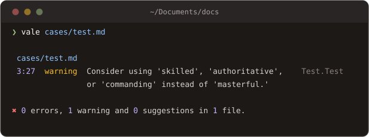

# substitution

Learn about the substitution extension point.

| Name         | Type    | Description                                                               |
| ------------ | ------- | ------------------------------------------------------------------------- |
| `affix`      | `string`| Names an affix file, so a `word/FLAGS` key matches every form its flags name. See [Affix flags](existence.md#affix-flags). |
| `ignorecase` | `bool`  | Makes all matches case-insensitive.                                       |
| `matchcase`  | `bool`  | Adapts the replacement to the case of the matched text, so a rule written as `A-OK` still suggests `a-ok` for `a ok`. |
| `nonword`    | `bool`  | Removes the default word boundaries (`\b`).                               |
| `swap`       | `map`   | A sequence of `observed: expected` pairs.                                 |
| `exceptions` | `array` | An array of strings to be ignored.                                        |
| `vocab`      | `bool`  | If false, disables all active vocabularies for this rule (default: true). |
| `capitalize` | `bool`  | Matches the capitalization of the source token.                           |

`substitution` associates a string with a preferred form.

```yaml
extends: substitution
message: Consider using '%s' instead of '%s'
level: warning
ignorecase: false
# swap maps tokens in form of bad: good
swap:
  abundance: plenty
  accelerate: speed up
```

> There is an abundance of ways to accelerate this.

```bash
test.md:1:13:style.Preferred:Consider using 'plenty' instead of 'abundance'
test.md:1:34:style.Preferred:Consider using 'speed up' instead of 'accelerate'
```

If we want to suggest the use of “plenty” instead of “abundance,” for example, we’d write:

```yaml
swap:
  abundance: plenty
```

A space between words in a key matches a line break too, so a phrase is found however the paragraph was wrapped, and the alert's message shows it on one line.

## Regex keys

The keys may also be regular expressions:

```yaml
swap:
  '(?:give|gave) rise to': lead to
```

You can also reference capture groups for more dynamic substitutions:

```yaml
swap:
  'within the (\w+) directory': in the $1 directory
```

> The file is within the config directory.

```bash
test.md:1:13:style.Paths:Consider using 'in the config directory' instead of 'within the config directory'
```

## Affix flags


Requires Vale v3.25.0 or later.


With [`affix`](existence.md#affix-flags) set, a key written as `word/FLAGS` matches every form its flags name. The value is the replacement for all of them, as written:

```yaml
extends: substitution
message: Use '%s' instead of '%s'.
affix: en_US-web
swap:
  utilize/DGS: use   # utilize, utilized, utilizes, utilizing
```

## Multiple suggestions

In some cases, you may want to suggest multiple alternatives for a single token. You can do this by separating them with a pipe ("|"):

```yaml
extends: substitution
# NOTE: We don't quote the first '%s':
message: Consider using %s instead of '%s.'
level: warning
# NOTE: The action is required.
action:
  name: replace
swap:
  # You can suggest multiple alternatives for a single token
  # by separating them with a pipe ("|").
  masterful: skilled|authoritative|commanding
```

In the CLI, this will render as a sentence with multiple suggestions:



In LSP-based editors, the suggestions will be presented as a list of ‘Quick Fixes’. See the [LSP guide](../guides/lsp.md) for more information.

## message

`substitution` can have one or two `%s` format specifiers in its message. This allows us to do either of the following:

```yaml
message: "Consider using '%s' instead of '%s'."
# or
message: "Consider using '%s'."
```
